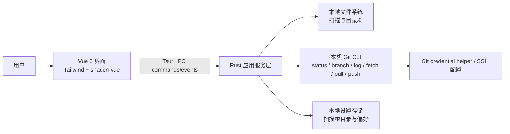

# RepoDeck 技术开发说明书

> 文档状态：技术设计与实现记录。方案逐步落地中；第 1 节“当前实现映射”列出已落地代码，后续章节描述方案和仍需补齐的边界。
>
> 状态标记：**已确认**为用户指定；**建议**为技术方案；**待确认**为仍影响实现的选择。

## 1. 技术目标与需求映射

以本地桌面应用聚合多个 Git 仓库信息和安全操作，覆盖项目说明书中的 FR-001 至 FR-012。首期避免引入不必要的服务端，Git 操作交由本机 Git 环境完成，配置留在用户本机。

## 当前实现映射

| 已落地模块 | 实现位置 | 覆盖需求 |
|---|---|---|
| Vue 桌面工作台、仓库搜索和状态卡片 | `src/views/HomeView.vue` | FR-003、FR-005、FR-008、FR-009 |
| Tauri 初始化、目录根配置与仓库发现 | `src-tauri/src/lib.rs` | FR-001、FR-002、FR-010 |
| 工作区状态、远端与分支元信息 | `src-tauri/src/lib.rs` | FR-003、FR-005、FR-012 |
| 按需目录浏览、分支提交摘要 | `src/components/RepoTree.vue`、`src-tauri/src/lib.rs` | FR-004、FR-006 |
| fetch、快进拉取、推送、切换分支、upstream 设置 | `src-tauri/src/lib.rs` | FR-007、FR-012 |
| 选择文件、暂存、路径限定提交；用户选择 merge/rebase | `src/views/HomeView.vue`、`src-tauri/src/lib.rs` | FR-007、FR-011、FR-012 |
| 选中仓库的批量 Fetch 与可安全快进 | `src/views/HomeView.vue`、`src-tauri/src/lib.rs` | FR-008、FR-009 |

扫描最大深度当前固定为 5；`.git`、常见依赖/构建目录默认跳过，符号链接不跟随。提交数量限制 1–100，默认 10，已并入偏好设置。主题默认亮色，支持暗色、跟随系统及四种主题色；偏好保存在 WebView localStorage，并兼容旧版提交条数。Windows Git 命令统一使用 `CREATE_NO_WINDOW`。初始窗口按屏幕工作区及 DPI 缩放限制大小，路径显示与复制格式化后仍保留原始路径供原生调用。macOS 原生编译尚未在当前 Windows 环境验证。

## 2. 技术栈

| 组成 | 选择 | 状态与说明 |
|---|---|---|
| 桌面容器 | Tauri 2 | 用户确认，当前 Windows 桌面端已初始化并成功运行 |
| 前端 | Vue 3 + TypeScript + Vite | 已实现；macOS 原生运行仍待验证 |
| 样式 | Tailwind CSS 4 | 已实现 |
| UI 组件 | shadcn-vue | 已初始化，按需加入组件源文件 |
| 桌面后端 | Rust/Tauri commands | 已实现路径扫描、仓库状态查询与基础 Git 操作 |
| Git 引擎 | 本机 `git` CLI | 已实现；使用系统 Git、credential helper 与 SSH 配置 |
| 本地设置 | Tauri 应用配置目录中的 JSON；最近提交条数目前使用 WebView localStorage | 已实现扫描根目录持久化；其他偏好继续完善，不存仓库密钥 |
| 服务端 | 首期无 | 与已确认的“本机单用户、数据保存在本机”一致 |

## 3. 总体架构

前端只通过 Tauri IPC 请求扫描、查询和操作，不直接获得任意文件系统或 shell 能力。Rust 层负责路径校验、Git 命令参数、任务进度和结果归一化。

## 4. 模块职责

### 4.1 前端

- 扫描根目录管理、仓库列表、详情和过滤（FR-001、FR-003、FR-004）。
- 展示仓库/分支/提交/同步状态与推荐操作（FR-003 至 FR-006、FR-012）。
- 提交单项或批量操作请求，显示进度、确认和逐仓库结果（FR-007 至 FR-009）。
- 将运行状态与服务端返回的结构化错误代码映射成可读提示；原始命令输出仅在诊断详情中呈现。

### 4.2 Rust 应用服务层

- `RootManager`：添加、删除、去重和持久化扫描根路径（FR-001、FR-010）。
- `RepositoryScanner`：遍历目录、探测 Git 仓库、应用排除规则（FR-002）。
- `RepositoryInspector`：查询 status、remote、branch、upstream、提交摘要和差异计数（FR-003、FR-005、FR-006）。
- `TreeService`：按需读取目录节点，过滤内部元数据和排除目录（FR-004）。
- `GitRunner`：统一启动 Git 进程、超时、取消、输出编码和错误映射。
- `OperationService`：执行 checkout、fetch、pull、push、commit、merge/rebase 与状态驱动的批处理确认流程（FR-007、FR-008、FR-011、FR-012）。
- `JobRegistry`：保存正在运行任务及逐仓库结果，通过 Tauri events 推送状态（FR-009）。

模块名为逻辑边界建议，不要求首期按一模块一 crate 拆分。

## 5. 数据与生命周期

以下为逻辑数据，不预设具体数据库表：

| 数据 | 主要内容 | 生命周期 |
|---|---|---|
| 扫描根 | 规范化路径、根类型/探测方式、添加时间、排除偏好 | 保存在本地设置中，用户可移除 |
| 仓库摘要 | 仓库根路径、关联扫描根、最近检查时间 | 从文件系统与 Git 元数据实时派生；不持久缓存或只短暂缓存 |
| 仓库状态 | 当前分支、工作区状态、remotes、ahead/behind | 查询时生成，操作后刷新 |
| 分支 | 本地/远程引用名、upstream、最近提交摘要 | 按需查询；历史深度受上限控制 |
| 操作任务 | 任务类型、仓库、开始/结束时间、状态和错误摘要 | 首期运行期间保留；操作历史是否持久化待确认 |
| 提交预览 | 当前仓库状态、变更路径、暂存/未暂存/未跟踪分类 | 操作时实时派生；用户选择的提交范围、暂存结果和提交说明在写入前再次确认 |
| 用户偏好 | 主题、默认提交条数、扫描排除项等 | 保存在本机配置中 |

配置中不保存 SSH 私钥、PAT 或远端凭据。认证交由 Git 的 credential helper、SSH agent 和系统密钥链配置处理。

## 6. 扫描与仓库识别

1. 路径通过系统目录选择器或已保存配置进入后端；后端检查路径存在、可读，并规范化为绝对路径。
2. 若根目录自身为 Git 仓库，直接登记该仓库，不继续把它当集合目录递归扫描。
3. 集合目录按有限深度遍历，遇到 `.git` 目录或文件时以其对应工作树作为仓库，避免继续进入该仓库内部再次扫描。
4. 默认忽略 `.git` 内部目录及常见大型依赖/构建目录；具体默认清单和可配置性待确认。
5. 符号链接默认不跟随，防止循环和扫描范围意外扩大；该规则需跨平台验证。
6. 规范化仓库路径用于去重；嵌套仓库是否一并发现待确认。
7. 目录树按需读取，尊重 `.gitignore` 的细节（仅列出被忽略项作为设置，或默认隐藏）需要在 UI 设计阶段确认。

## 7. Git 命令与 IPC 设计

### 7.1 Git 进程调用原则

- 使用 Rust `std::process::Command` 或等价进程 API，将 Git 可执行文件、工作目录和参数分开传递；不得把用户路径拼成 shell 命令字符串。
- 启动时检测 Git 是否可用并显示版本/安装提示。Git 可执行文件发现策略（PATH、用户设置或自动探测）待实现阶段确定。
- 为每个仓库设置操作互斥，避免同一仓库并发 fetch/pull/checkout。
- 对可能长时间运行的网络命令提供超时与取消；取消不应宣称撤销已经完成的 Git 写入。
- 保留可诊断的 exit code 和 stderr 摘要，避免将凭据或环境秘密写入日志。
- 不使用 shell 执行任意命令，不接受前端自由传入 Git 子命令。

### 7.2 建议的 Tauri command 边界

以下是边界建议，参数/返回结构需在实现时定稿：

| Command 类别 | 典型用途 | 需求 |
|---|---|---|
| `roots_*` | 添加/移除/列出扫描根 | FR-001、FR-010 |
| `scan_*` | 扫描根、刷新仓库摘要 | FR-002、FR-003 |
| `repo_inspect` | 查询工作区、remote、branch、ahead/behind 和提交摘要 | FR-003、FR-005、FR-006、FR-012 |
| `tree_children` | 按路径读取下一层树节点 | FR-004 |
| `git_checkout` | 切换已存在本地分支 | FR-007 |
| `git_fetch` / `git_pull` / `git_push` | 单仓库 Git 操作 | FR-007 |
| `git_merge` / `git_rebase` | 用户主动选择并确认后整合远端提交；冲突后停止并交外部工具处理 | FR-007、FR-012 |
| `batch_sync` | 逐仓库安全同步并启动任务 | FR-008 |
| `repo_changes` / `git_stage` / `git_commit` | 查看变更文件、按用户选择暂存、校验说明并提交 | FR-011 |
| `job_cancel` | 请求取消尚可取消的任务 | FR-009 |

长任务建议通过 IPC event 回传 `jobId`、仓库标识、阶段、百分比（若可得）、结果状态及错误摘要。事件结构保持有限且可版本演进。

## 8. Git 操作策略

### 分支切换

- 首期仅切换到已存在的本地分支。
- 若工作区有未提交或未暂存的改动，默认拒绝切换并说明原因；是否允许用户显式确认切换待产品确认。
- 远端分支创建本地跟踪分支可列为后续增强。

### Fetch / Pull / Push / Merge / Rebase

- `fetch` 只更新远端引用，不修改工作区文件。
- fetch 后计算当前分支相对 upstream 的 ahead/behind 数。只有工作区干净、本地没有独有提交（`ahead = 0`）且远端有新提交（`behind > 0`）时，pull 才能直接 fast-forward。
- 本地与远端指向同一提交时显示已同步，不需要 pull。
- 本地领先时建议用户 push；分叉时显示两侧提交数并提供 merge、rebase、打开外部 Git 工具或跳过等按钮。Merge/rebase 由用户主动选择并二次确认，不在批处理里自动挑选策略。
- 用户选择 merge/rebase 后若发生冲突，停止自动后续步骤，保留 Git 冲突状态并提示用户打开 IDE/终端处理；首期不提供冲突解决 UI。
- `push` 使用当前分支及配置的 upstream；没有 upstream 时先提示并要求用户选择是否设置，不自动猜测推送目标。
- 对涉及覆盖、冲突解决或强制更新的情况不自动执行。

### 批量同步与提交确认

- 每个仓库独立排队和产生状态，批处理可限制并行数；首版建议同一时刻按仓库串行或低并发执行。
- 对每个仓库 fetch 并检查工作区状态、当前分支、upstream、ahead/behind 关系；只有工作区干净且本地落后的仓库直接 fast-forward。已同步状态只报告无需操作。
- 对 dirty、本地领先、分叉或缺少 upstream 的仓库逐项显示状态、建议和按钮；用户可以提交后继续、push、选择 merge/rebase、选择 upstream、打开外部工具或跳过，具体按钮由状态决定。
- 用户确认先提交再拉取后，展示变更文件清单，支持按文件选择和暂存，并要求提交说明。提交前展示将纳入的文件及说明，等待用户确认。
- 只提交用户明确选择的路径；已有暂存内容也要纳入提交预览，避免无提示地提交无关暂存改动。被排除的改动必须保持原状态。
- 提交钩子或 Git 提交失败时停止该仓库后续 pull，并保留逐项错误详情。
- 提交成功后再 fetch/pull；如果之后失败，任务结果同时记录 commit 已完成、pull 未完成。
- 直接拉取仅对当前分支执行 fast-forward；分叉时 merge/rebase 需要用户明确选择并二次确认。
- 若分支已分叉，提交本身不能解决分叉。用户选择 merge/rebase 后若有冲突，提示其在 IDE/终端继续；不自动解决冲突或强制更新。
- 若缺少 upstream 或同名远端分支，提示用户选择远端分支/跳过；不能以先提交作为替代。
- 结果状态至少区分 `success`、`skipped`、`failed`、`cancelled`，错误代码便于前端本地化。
- 一个仓库失败不得中止其他仓库。
- 批量“同名分支”严格定义（当前分支的同名 upstream 或遍历每个本地分支）待用户确认。

## 9. 安全与隐私

- 所有仓库内容默认留在用户本机，首期不上传源文件或 Git 历史。
- Tauri capabilities 只暴露所需 command；前端不得获得 unrestricted shell 或任意路径读写 API。
- 验证扫描根和仓库路径；在执行命令时将选中的仓库目录作为工作目录，参数来自受控枚举与已解析引用。
- 用户选择的目录才属于扫描范围；符号链接策略和扫描深度需可预测并可解释。
- Git 网络访问遵循用户配置的远端与凭据助手。应用不记录密码、令牌或私钥。
- 错误日志需过滤可能包含凭据的 URL 与环境值；是否提供“复制诊断包”功能后续评估。
- 本地配置权限遵循 OS 应用数据目录默认权限，不保存敏感凭据。

## 10. 错误处理与可观测性

- 统一错误类别：路径无效、权限不足、非仓库、Git 未安装、认证失败、网络失败、分支状态不适用、冲突/分叉、操作超时、用户取消、内部错误。
- 用户提示使用明确的下一步建议；原始 Git 输出以折叠的诊断信息呈现。
- 扫描部分失败时仍保留成功发现的仓库，并汇总无法访问路径。
- 批处理结束保留整体计数和逐项详情；刷新失败不得抹掉上次成功结果而不提示数据陈旧。
- 默认不长期记录源代码内容或完整 Git 命令输出。诊断日志策略与保留期限待确认。

## 11. 性能与质量策略

- 扫描及 Git 命令通过后台任务执行，不占用 UI 主线程。
- 目录树按需加载；提交历史只取最近 N 条；状态可短时缓存并在 Git 写操作后失效。
- 仓库列表刷新可设置并发上限，避免大量子进程同时启动。
- 单仓库状态检查、扫描规则和操作安全判断应可独立验证；跨平台验收覆盖 Windows/macOS 路径、编码和进程行为。
- 建议质量覆盖：仓库识别边界、`.git` 文件 worktree、无 upstream、dirty worktree、fast-forward、分叉、网络失败、批处理部分失败、路径含空格/非 ASCII 字符。
- 具体测试框架、CI 系统和自动化程度待创建仓库后决定。

## 12. 开发、构建与发布

- 本地开发需 Node.js 包管理环境、Rust 工具链及平台原生构建依赖，并安装 Git。
- 前端使用 Vite 开发服务器，Tauri 开发命令同时启动 Rust 宿主。
- Windows 产物格式、macOS DMG/PKG、签名与公证流程，以及是否覆盖 macOS Intel/Apple Silicon 均待确认。
- 最低 Windows/macOS 版本、升级/自动更新、代码签名证书和发布渠道待确认。
- 首期可先提供本机开发运行与手工构建；正式分发前补齐签名、公证、升级和发布自动化决策。

## 13. 技术风险与待决策

| 风险/事项 | 建议处理 | 状态 |
|---|---|---|
| 本机 Git 不存在或版本过旧 | 启动探测并提供清晰安装/配置指引 | 建议 |
| Git CLI 认证依赖用户环境 | 复用 Git credential helper/SSH，不自建密钥存储 | 建议 |
| 集合目录很大 | 有限深度、排除项、并发上限、按需展示 | 建议，细节待确认 |
| dirty 状态下同步 | 已确认需逐项提示，并询问是否先提交再拉取；提供文件选择、暂存和提交说明 | 已确认 |
| 分支关系处理 | 只有 clean + behind-only 直接 fast-forward；其他状态先提示并给状态对应按钮 | 已按用户确认的交互原则更新 |
| Git URL 中可能含凭据 | 日志和错误展示过滤敏感部分 | 建议 |
| 多平台文件路径和进程输出差异 | Windows/macOS 分别验收路径、编码、取消和权限行为 | 建议 |
| 扫描结果缓存与历史持久化 | 首期仅持久化根路径和偏好，状态实时派生 | 建议 |
| 前端/后端依赖具体版本 | 初始化时选用兼容的稳定版本并锁定依赖 | 待实现阶段确定 |
